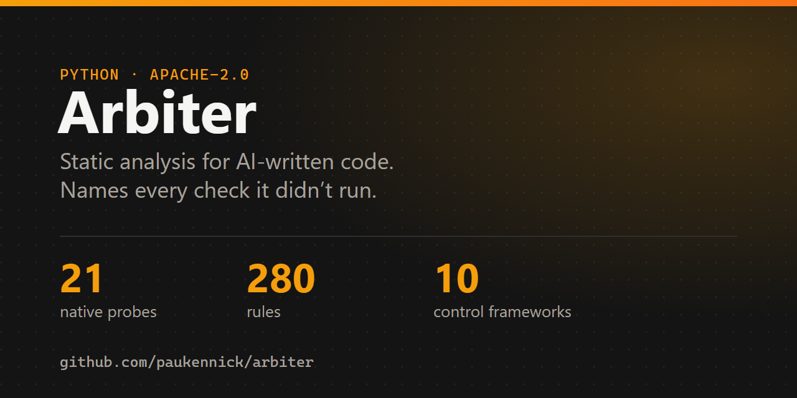
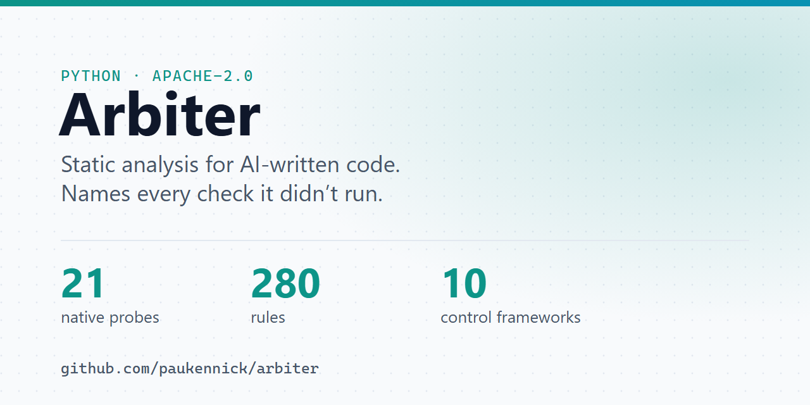
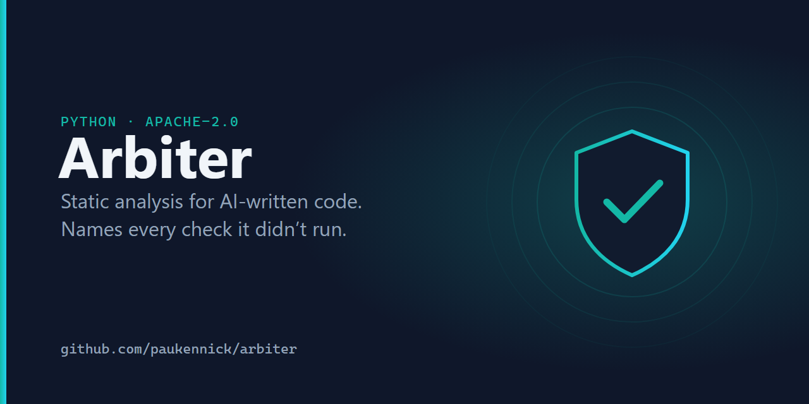
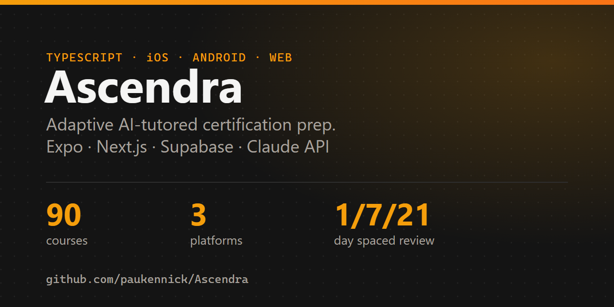
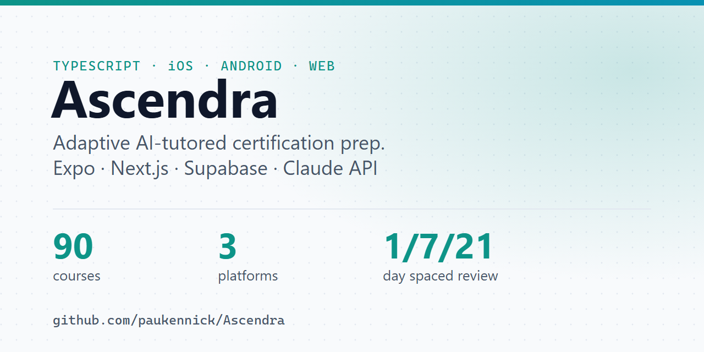
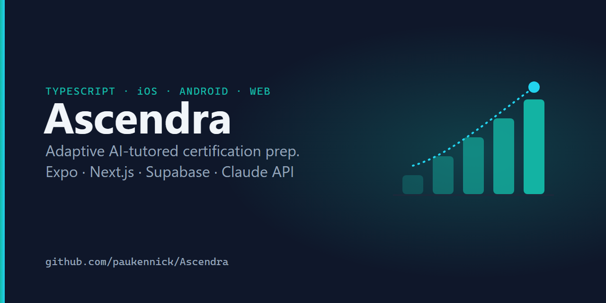
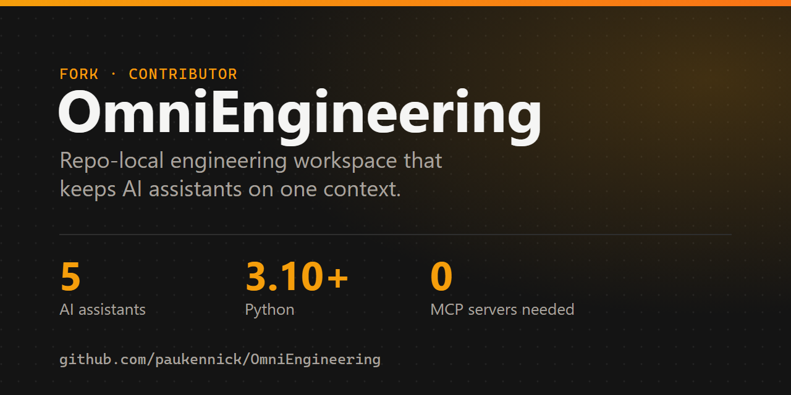
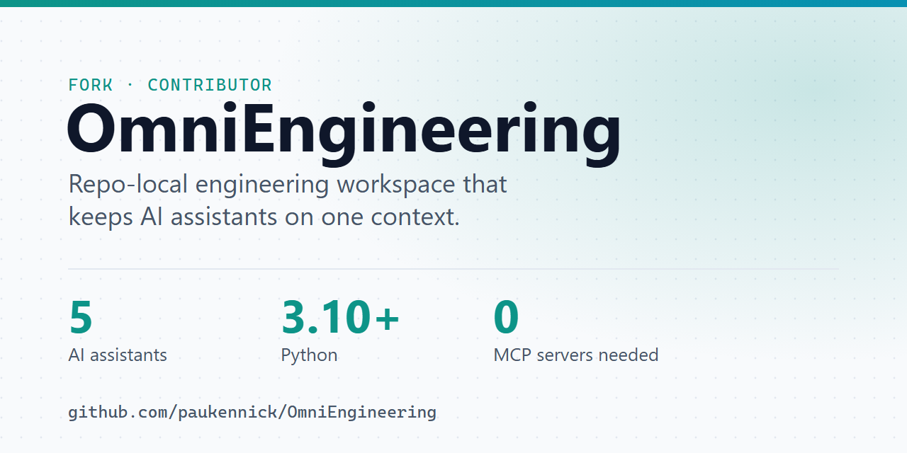

# Image options

Social preview (1280×640) options for each public repo. A = stats on dark, B = stats on light, C = emblem. Upload the chosen PNG in that repo's Settings → Social preview. Regenerate with `python tools/build.py` then `tools/render_png.ps1`.

## Arbiter

| A | B | C |
|---|---|---|
|  |  |  |

## Ascendra

| A | B | C |
|---|---|---|
|  |  |  |

## OmniEngineering

| A | B | C |
|---|---|---|
|  |  |  |
