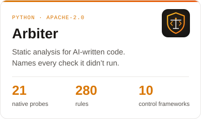
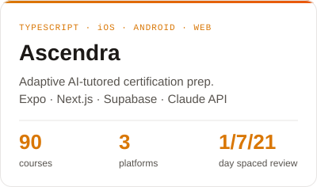
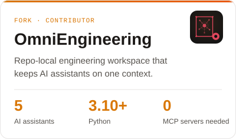

<picture>
  <source media="(prefers-color-scheme: dark)" srcset="assets/banner-dark.svg">
  
</picture>

I build tools that check AI-written code and report how much they could actually check.
Most of my work is in SRE and DevSecOps: static analysis with measured precision, and requirements you can trace from spec to test.

- **Currently:** hardening Arbiter's rule packs against a labelled corpus of AI-written services.
- **Open to:** SRE, DevSecOps and platform security roles in the Seattle area or remote.

## Featured work

<table>
  <tr>
    <td width="33%" valign="top">
      <a href="https://github.com/paukennick/arbiter">
        <picture>
          <source media="(prefers-color-scheme: dark)" srcset="assets/card-arbiter-dark.svg">
          
        </picture>
      </a>
    </td>
    <td width="33%" valign="top">
      <a href="https://github.com/paukennick/Ascendra">
        <picture>
          <source media="(prefers-color-scheme: dark)" srcset="assets/card-ascendra-dark.svg">
          
        </picture>
      </a>
    </td>
    <td width="33%" valign="top">
      <a href="https://github.com/paukennick/OmniEngineering">
        <picture>
          <source media="(prefers-color-scheme: dark)" srcset="assets/card-omni-dark.svg">
          
        </picture>
      </a>
    </td>
  </tr>
</table>

## Toolbox

**Code and infrastructure as code** &nbsp;

**AWS (incl. GovCloud)** &nbsp;

**DevSecOps** &nbsp;

**Compliance** &nbsp;

**Systems and delivery** &nbsp;

## How I work

- **Measure before claiming.** Arbiter keeps a per-rule precision ledger and withholds its grade when it couldn't check enough of the code.
- **Trace every change to a requirement.** Requirement IDs tie code, tests and docs together, so drift shows up in review instead of in production.

## Contact

